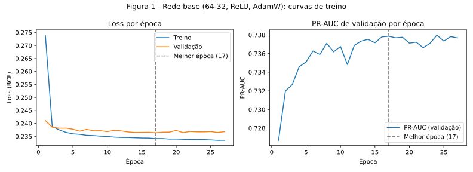

# 2. Classificação

!!! abstract "Entrega 2 de 3 do [Projeto](../index.md)"

    [Projects → Classification](https://insper.github.io/ann-dl/){:target='_blank'}

!!! info "Equipe"

    | Nome completo | E-mail | GitHub |
    |---------------|--------|--------|
    | Luana Prado Lopes Guimaraes | luanaplg@al.insper.edu.br | LuanaPLGuimaraes |
    | Laura Pontiroli Machado | laurapm@al.insper.edu.br | laupontiroli |

    Dataset, decisões e status: [página do projeto](../index.md).

Esta entrega parte do [EDA](../eda/index.md), que já caracterizou o dataset em profundidade. Aqui resumimos e apontamos para lá em vez de repetir a análise.

## Escolha do dataset

Usamos o dataset **Playground Series S6E9 – Predicting Electric Vehicle Purchases**, do Kaggle ([link](https://www.kaggle.com/competitions/playground-series-s6e9)). O arquivo de treino tem 668.665 linhas, 13 variáveis explicativas, um `id` e o alvo `Will_Buy_EV` (Yes/No). A tarefa é uma classificação binária que não é trivial por três motivos: o alvo é desbalanceado (17,46% "Yes"), as variáveis misturam tipos numéricos e categóricos, e os dados têm particularidades que o EDA documentou (valores acumulados no piso de renda e deslocamento, e uma variável que praticamente entrega a resposta).

## Descrição do dataset

- **Alvo:** `Will_Buy_EV` (compra de veículo elétrico, Yes/No), com 82,54% "No" e 17,46% "Yes".
- **Numéricas (7):** `Age`, `Annual_Income_USD`, `Daily_Commute_km`, `Number_of_Cars_Owned`, `Charging_Stations_Near_Home`, `Charging_Stations_Near_Work` e `Environmental_Concern_Level`.
- **Categóricas (5):** `Gender`, `City_Type`, `Current_Car_Type`, `Home_Charging_Possible` e `Subsidy_Available`.
- **Descartada:** `Range_Anxiety_Level`, por quase determinar o alvo (vazamento).

**Problemas herdados do EDA que esta entrega precisa tratar:** o desbalanceamento do alvo; os valores no piso (9,20% da renda é exatamente 30.000 e 21,59% do deslocamento é exatamente 5 km), tratados com indicador de ausência e mediana; os outliers, tratados por winsorização; e o risco de vazamento, evitado ao descartar `Range_Anxiety_Level` e ao ajustar o pré-processamento só no treino.

## 0. Ponto de partida

**Dados e divisão.** O conjunto de treino tem 534.932 linhas e o de teste, 133.733 (divisão 80/20 estratificada, `random_state=42`, a mesma do [EDA](../eda/index.md)). A validação foi retirada do treino: 427.945 linhas para ajuste e 106.987 para validação, também estratificada com seed 42. A proporção do alvo é 82,54% "No" e 17,46% "Yes" nos três conjuntos. **O teste só será usado uma vez, na etapa 5.**

**Pré-processamento.** Reutilizamos o pipeline definido no [plano de pré-processamento do EDA](../eda/index.md#8-plano-de-pre-processamento), implementado em `eda/code/preprocess.py`: tratamento dos valores no piso (renda = 30.000 e deslocamento = 5 km) com indicador de ausência e imputação pela mediana, winsorização por IQR, padronização das numéricas e one-hot das categóricas. `Range_Anxiety_Level` e `id` são descartados. O pipeline é ajustado somente nas linhas de ajuste, nunca na validação nem no teste. `Subsidy_Available` é mantida (justificativa na etapa 1).

**Métrica principal: PR-AUC da classe "Yes" com apoio da F1** (área sob a curva precisão-recall, calculada como *average precision*). Escolhida *antes* de treinar a rede porque:

- o alvo é desbalanceado (17,46% "Yes"): a acurácia engana, já que o Dummy acerta 82,54% sem aprender nada;
- ela avalia o ordenamento das probabilidades em todos os cortes, sem depender do corte de 0,5, o que mantém a comparação justa quando a rede usar ponderação de classes (que desloca as probabilidades);
- um modelo que ordena ao acaso obtém PR-AUC igual à proporção de "Yes" (17,46%), e o perfeito obtém 100%.

Reportamos também precisão, recall, F1, F1 macro, acurácia balanceada e ROC-AUC como métricas secundárias.

**Critério de sucesso (definido antes de treinar a rede):** a PR-AUC da rede no teste, em média de 3 seeds, deve superar a da melhor baseline no teste em pelo menos 1 ponto percentual, e essa diferença deve ser maior que o desvio padrão entre as seeds. O limiar de 1 ponto é uma escolha de julgamento: as duas baselines diferem em apenas 0,08 ponto de PR-AUC na validação, então diferenças bem menores que 1 ponto não se distinguem de ruído.

!!! note "Desbalanceamento"

    Nas baselines nenhum balanceamento foi aplicado. A decisão sobre pesos na perda ou reamostragem para a rede será tomada e registrada nas etapas 2 e 4.

## 1. Baselines

Os três modelos usam o mesmo pipeline e foram avaliados na validação (o teste não foi tocado), com corte de decisão 0,5 e sem balanceamento de classes. Valores em %:

| Modelo | Acurácia | Acur. balanceada | Precisão | Recall | F1 | ROC AUC | PR-AUC |
|---|---|---|---|---|---|---|---|
| Dummy (classe majoritária) | 82,54 | 50,00 | 0,00 | 0,00 | 0,00 | 50,00 | 17,46 |
| Regressão logística | 89,24 | 79,44 | 71,21 | 64,39 | 67,63 | 93,57 | 73,72 |
| Random forest | 89,33 | 79,20 | 72,01 | 63,63 | 67,56 | 93,50 | 73,80 |

**Interpretação.**

- O Dummy acerta 82,54% apenas por dizer sempre "No", o que mostra que a acurácia sozinha não serve nesse caso. Sua PR-AUC de 17,46% é o patamar do acaso.
- Regressão logística e random forest empatam (diferença de 0,08 ponto de PR-AUC e 0,07 de F1). Um modelo simples e quase linear chega ao mesmo resultado que um modelo complexo, o que sugere que a relação entre as variáveis e o alvo é em grande parte direta. Os hiperparâmetros da random forest (100 árvores, profundidade máxima 20) não foram otimizados, então o empate vale para essa configuração.
- Com corte 0,5, o recall é de ~64%: cerca de um terço dos compradores reais não é encontrado, embora o ROC AUC seja alto (~93,5). Esse corte será revisitado na etapa 5.
- **Subsídio:** sem `Subsidy_Available`, a PR-AUC cai de ~73,7 para ~58,8 (regressão logística) e o F1 de ~67,6 para ~51,1. A variável carrega muita informação e é mantida.

## 2. A rede

**Arquitetura.** Perceptron multicamadas com 21 entradas (as colunas do pipeline), duas camadas ocultas de 64 e 32 neurônios e uma única unidade de saída que devolve um *logit*. A implementação está em `code/network.py`.

| | Escolha | Por quê |
|---|---------|---------|
| Camadas ocultas | 64 → 32 | As baselines mostraram uma relação quase linear (a regressão logística empata com a random forest), então não há motivo para uma rede grande. Duas camadas permitem capturar interações entre variáveis, e o funil resume a informação em conceitos mais compactos. |
| Ativação | ReLU | Não satura e deixa o gradiente passar onde está ativa (a sigmoid o encolhe até 4 vezes por camada). |
| Saída | 1 unidade, sem ativação (logit) | Classificação binária. A sigmoid fica dentro da perda. |
| Perda | `BCEWithLogitsLoss` | Combina sigmoid e entropia cruzada de forma numericamente estável. Na rede base não usamos pesos de classe (ficam para a etapa 4). |
| Inicialização | He (Kaiming) | Escala os pesos por √(2/n) para manter a variância dos sinais estável com ReLU, evitando que o sinal ou o gradiente encolham ou explodam no início do treino. Os biases começam em zero. |

**Parâmetros vs. dados.** A rede tem 3.521 parâmetros (21×64+64, 64×32+32 e 32+1) para 427.945 linhas de ajuste, cerca de 1 parâmetro para cada 121 linhas. Há muito dado por parâmetro, o que torna o overfitting pouco provável, e isso é verificado na etapa 3.

## 3. Treinamento

**Configuração.** Otimizador AdamW sem weight decay, taxa de aprendizado 0,001, batch de 1.024, no máximo 100 épocas e early stopping sobre a loss de validação (paciência de 10 épocas, restaurando os pesos da melhor época). Seed 42. O código está em `code/train.py` e `code/data_prep.py`, e a validação é a mesma das baselines.

- **AdamW:** adapta o passo de cada peso e converge rápido sem muito ajuste. O weight decay é zero aqui, porque a rede base é a referência *sem regularização* da etapa 4.
- **Taxa 0,001:** valor usual do Adam. É um ponto de partida, e a taxa entra na busca da etapa 4.
- **Batch 1.024:** com 428 mil linhas, lotes grandes dão correções estáveis e épocas rápidas (~0,6 s em CPU). O custo é menos ruído nos passos.
- **Early stopping pela loss de validação:** é uma curva suave, boa de ler. A PR-AUC de validação é registrada a cada época.

/// caption
**Figura 1** — Loss de treino e de validação (esquerda) e PR-AUC de validação (direita) por época. A linha tracejada marca a melhor época.
///

**Leitura das curvas.** A rede converge: a loss cai muito nas duas primeiras épocas e depois quase estabiliza. A melhor época pela loss de validação é a 17 (0,2364), e o treino parou na 27, que é 17 mais a paciência de 10. A partir da época 17 a loss de treino continua caindo devagar (0,2342 → 0,2335), mas a de validação fica estável em ~0,2365, o que indica um overfitting leve, com distância de só ~0,002 entre as duas curvas. Isso é coerente com a rede ter poucos parâmetros para muitos dados. A PR-AUC de validação estabiliza em ~0,738 a partir da época 13 e oscila cerca de ±0,001 entre épocas.

**Rede base na validação** (melhores pesos, corte 0,5, em %):

| Modelo | Acurácia | Acur. balanceada | Precisão | Recall | F1 | ROC AUC | PR-AUC |
|---|---|---|---|---|---|---|---|
| Regressão logística | 89,24 | 79,44 | 71,21 | 64,39 | 67,63 | 93,57 | 73,72 |
| Random forest | 89,33 | 79,20 | 72,01 | 63,63 | 67,56 | 93,50 | 73,80 |
| Rede base | 89,24 | 80,12 | 70,44 | 66,11 | 68,21 | 93,60 | 73,79 |

Na métrica principal, a rede base empata com as baselines (diferença de menos de 0,1 ponto). O F1 e o recall ligeiramente maiores refletem uma troca entre precisão e recall no corte 0,5, e não um melhor ordenamento dos clientes, que é o que a PR-AUC mede. Os números da rede estão levemente otimistas, porque a validação foi usada para escolher a melhor época e a estimativa não enviesada virá do teste, na etapa 5.

## 4. Regularização e hiperparâmetros

**Protocolo.** Treinamos 12 configurações da rede (seed 42, early stopping pela loss de validação) e as comparamos pela **PR-AUC de validação na melhor época**. O teste não foi usado. Como as diferenças são pequenas, as 3 melhores foram refeitas com 3 seeds (42, 43 e 44), e a escolha final seguiu a maior média, regra definida antes dos resultados. O código está em `code/search.py`.

Técnicas comparadas com a rede sem nenhuma regularização:

- **Weight decay:** penaliza pesos grandes, forçando a rede a ser mais simples.
- **Dropout:** desliga neurônios ao acaso durante o treino, para a rede não depender de poucos neurônios.
- **BatchNorm:** reescala as ativações de cada camada por lote, estabilizando o treino, com leve efeito regularizador.

Também variamos o peso da classe rara, a largura e profundidade, a ativação e a taxa de aprendizado.

**Resultados**, ordenados pela PR-AUC de validação (em %):

| # | Configuração | Parâmetros | Melhor época | Loss treino | Loss val | PR-AUC val |
|---|---|---|---|---|---|---|
| 1 | Ativação tanh | 3.521 | 17 | 0,2348 | 0,2359 | 73,90 |
| 2 | Dropout 0,3 | 3.521 | 16 | 0,2394 | 0,2360 | 73,89 |
| 3 | Dropout 0,1 + weight decay 1e-2 | 3.521 | 28 | 0,2354 | 0,2358 | 73,89 |
| 4 | Dropout 0,1 | 3.521 | 28 | 0,2354 | 0,2359 | 73,86 |
| 5 | Menor (32-16) | 1.249 | 32 | 0,2342 | 0,2360 | 73,81 |
| 6 | Weight decay 1e-2 | 3.521 | 17 | 0,2341 | 0,2363 | 73,79 |
| 7 | BatchNorm | 3.713 | 32 | 0,2330 | 0,2365 | 73,79 |
| 8 | Base (64-32, sem regularização) | 3.521 | 17 | 0,2342 | 0,2364 | 73,79 |
| 9 | Weight decay 1e-4 | 3.521 | 17 | 0,2341 | 0,2364 | 73,76 |
| 10 | Mais larga (128-64) | 11.137 | 15 | 0,2336 | 0,2366 | 73,75 |
| 11 | Learning rate 3e-4 | 3.521 | 35 | 0,2340 | 0,2367 | 73,71 |
| 12 | Peso da classe rara (4,73) | 3.521 | 15 | 0,5127* | 0,5184* | 73,58 |

\* Com peso de classe, a loss é ponderada e não é comparável com as demais. Nas configurações com dropout, a loss de treino é medida com neurônios desligados, por isso fica mais alta.

**Confirmação das 3 melhores com 3 seeds:**

| Configuração | PR-AUC val média (%) | Desvio (pontos) | Por seed (%) |
|---|---|---|---|
| Dropout 0,1 + weight decay 1e-2 | 73,93 | 0,05 | 73,89 / 73,91 / 73,99 |
| Ativação tanh | 73,89 | 0,01 | 73,90 / 73,90 / 73,88 |
| Dropout 0,3 | 73,88 | 0,03 | 73,89 / 73,85 / 73,91 |

**Configuração escolhida: 64-32 com dropout 0,1 e weight decay 1e-2** (3.521 parâmetros).

**Interpretação.**

- Todas as configurações ficam em uma faixa estreita (73,6 a 73,9). O dropout traz um ganho pequeno e consistente, enquanto o weight decay sozinho e o BatchNorm não mudam a PR-AUC. Isso é coerente com o overfitting ser leve já na rede base (etapa 3), de modo que há pouco para a regularização corrigir.
- Aumentar a rede (128-64) não ajuda, e uma rede bem menor (32-16, 1.249 parâmetros) empata com a base. A capacidade não é o fator limitante, o que combina com a relação quase linear sugerida pelo empate das baselines.
- O peso da classe rara reduziu a PR-AUC. O efeito esperado dele é deslocar as probabilidades, o que interessa à escolha do corte (etapa 5), e não à ordenação medida pela PR-AUC.
- As 3 melhores configurações diferem entre si menos do que o desvio entre seeds, então a escolha final é praticamente um empate. A configuração escolhida supera a base em cerca de 0,1 ponto de PR-AUC, valor maior que o desvio entre seeds (0,05) mas bem abaixo do 1 ponto do critério da etapa 0. A seleção entre 12 configurações na mesma validação também tende a ser levemente otimista, e a estimativa limpa virá do teste.

## 5. Avaliação no teste

<!-- Exigido: retreinar a config escolhida e avaliar UMA vez; matriz de confusão; precisão/revocação/F1 por classe; F1 macro; ROC-AUC; curva PR e PR-AUC; corte escolhido na validação e justificado pelo custo do erro; tabela rede + baselines no mesmo teste; 3 seeds (média ± desvio); a diferença é maior que a variação?; critério da etapa 0 atingido? -->

(a preencher)

## 6. Análise de erros

<!-- Exigido: erro por subgrupo (uma categoria da EDA e faixas do alvo/numérica); piores exemplos com hipótese por padrão; importância por permutação vs. o que a EDA sugeria. -->

(a preencher)

## 7. Conclusão

<!-- Exigido: "A rede valeu a pena?"; limitações; quem é afetado por um erro do modelo; próximos passos. -->

(a preencher)

## Referências

(a preencher)

## Resumo dos resultados

| # | Item | Resultado |
|---|------|-----------|
| 1 | Dataset, tarefa, alvo e métrica principal | Playground Series S6E9; classificação binária; `Will_Buy_EV`; PR-AUC da classe "Yes" |
| 2 | Linhas de treino · validação · teste | 427.945 · 106.987 · 133.733 |
| 3 | Melhor baseline e sua métrica no teste | (a preencher na etapa 5) |
| 4 | Rede escolhida: camadas × unidades, nº de parâmetros, regularização | (a preencher) |
| 5 | Otimizador, learning rate, batch, época de parada | (a preencher) |
| 6 | Métrica principal da rede no teste (média ± desvio, 3 seeds) | (a preencher) |
| 7 | Critério de sucesso atingido? | (a preencher) |
| 8 | Subgrupo com maior erro e seu valor | (a preencher) |