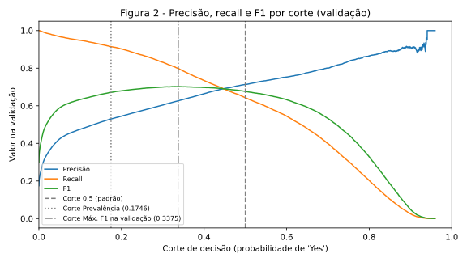
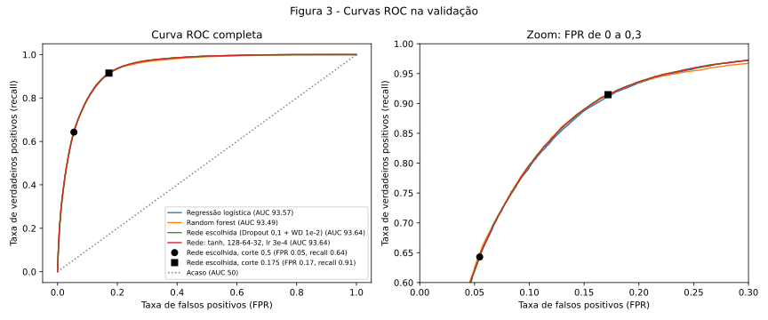
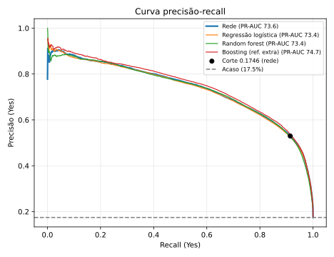
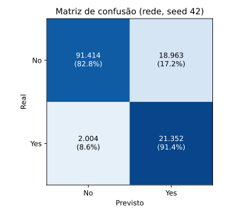
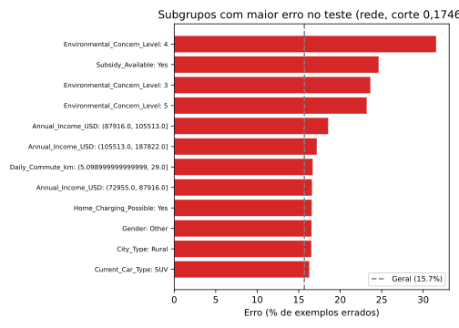
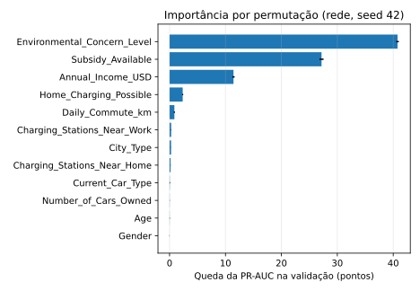
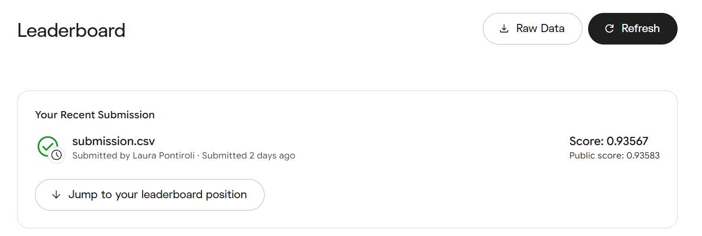

# 2. Classificação

!!! abstract "Entrega 2 do [Projeto](../index.md)"

    [Projects → Classification](https://insper.github.io/ann-dl/){:target='_blank'}

!!! info "Equipe"

    | Nome completo | E-mail | GitHub |
    |---------------|--------|--------|
    | Luana Prado Lopes Guimaraes | luanaplg@al.insper.edu.br | LuanaPLGuimaraes |
    | Laura Pontiroli Machado | laurapm@al.insper.edu.br | laupontiroli |

    Dataset, decisões e status: [página do projeto](../index.md).

Esta entrega parte do [EDA](../eda/index.md), que já caracterizou o dataset em profundidade. Aqui resumimos e apontamos para lá em vez de repetir a análise.

## Escolha do dataset

Usamos o dataset **Playground Series S6E9 – Predicting Electric Vehicle Purchases**, do Kaggle ([link](https://www.kaggle.com/competitions/playground-series-s6e9)). O arquivo de treino tem 668.665 linhas, 13 variáveis explicativas, um `id` e o alvo `Will_Buy_EV` (Yes/No). A tarefa é uma classificação binária que não é trivial por três motivos: o alvo é desbalanceado (17,46% "Yes"), as variáveis misturam tipos numéricos e categóricos, e os dados têm particularidades que o EDA documentou (valores acumulados no piso de renda e deslocamento, e uma variável que praticamente entrega a resposta).

## Descrição do dataset

- **Alvo:** `Will_Buy_EV` (compra de veículo elétrico, Yes/No), com 82,54% "No" e 17,46% "Yes".
- **Numéricas (7):** `Age`, `Annual_Income_USD`, `Daily_Commute_km`, `Number_of_Cars_Owned`, `Charging_Stations_Near_Home`, `Charging_Stations_Near_Work` e `Environmental_Concern_Level`.
- **Categóricas (5):** `Gender`, `City_Type`, `Current_Car_Type`, `Home_Charging_Possible` e `Subsidy_Available`.
- **Descartada:** `Range_Anxiety_Level`, por quase determinar o alvo (vazamento).

**Problemas herdados do EDA que esta entrega precisa tratar:** o desbalanceamento do alvo; os valores no piso (9,20% da renda é exatamente 30.000 e 21,59% do deslocamento é exatamente 5 km), tratados com indicador de ausência e mediana; os outliers, tratados por winsorização; e o risco de vazamento, evitado ao descartar `Range_Anxiety_Level` e ao ajustar o pré-processamento só no treino.

## 0. Ponto de partida

**Dados e divisão.** O conjunto de treino tem 534.932 linhas e o de teste, 133.733 (divisão 80/20 estratificada, `random_state=42`, a mesma do [EDA](../eda/index.md)). A validação foi retirada do treino: 427.945 linhas para ajuste e 106.987 para validação, também estratificada com seed 42. A proporção do alvo é 82,54% "No" e 17,46% "Yes" nos três conjuntos. Segundo recomendações do projeto, o teste só será usado uma vez, na etapa 5.

**Pré-processamento.** Reutilizamos o pipeline definido no [plano de pré-processamento do EDA](../eda/index.md#8-plano-de-pre-processamento), implementado em `eda/code/preprocess.py`: tratamento dos valores no piso (renda = 30.000 e deslocamento = 5 km) com indicador de ausência e imputação pela mediana, winsorização por IQR, padronização das numéricas e one-hot das categóricas. `Range_Anxiety_Level` e `id` são descartados. O pipeline é ajustado somente nas linhas de ajuste, nunca na validação nem no teste. `Subsidy_Available` é mantida (justificativa na etapa 1).

**Métrica principal: PR-AUC da classe "Yes" com apoio da F1 e Recall** (área sob a curva precisão-recall, calculada como *average precision*). Escolhida antes de treinar a rede e decidida dado que:

- o alvo é desbalanceado (17,46% "Yes"): a acurácia engana, já que o Dummy acerta 82,54% sem aprender nada;
- ela avalia o ordenamento das probabilidades em todos os cortes, sem depender do corte de 0,5, o que mantém a comparação justa quando a rede usar ponderação de classes (que desloca as probabilidades);
- um modelo que ordena ao acaso obtém PR-AUC igual à proporção de "Yes" (17,46%), e o perfeito obtém 100%.

Reportamos também precisão, recall, F1, F1 macro, acurácia balanceada e ROC-AUC como métricas secundárias.

!!! note "Métricas em destaque a partir da etapa 5"

    A métrica principal e o critério de sucesso abaixo não mudam. Entre as secundárias, passamos a destacar duas, decisão tomada depois dos resultados da etapa 4 e registrada na [página do projeto](../index.md#registro-de-decisoes):

    - **Recall da classe "Yes":** o corte de decisão escolhido (etapa 5) prioriza encontrar compradores, então o recall é o que mostra se esse objetivo foi atingido.
    - **ROC AUC e curva ROC:** são as métricas que permitem comparar nosso resultado com o de outros grupos que trabalham na mesma competição.

    Precisão e F1 continuam reportadas, porque mostram o custo do recall alto.

**Critério de sucesso:** a PR-AUC da rede no teste, em média de 3 seeds, deve superar a da melhor baseline no teste em pelo menos 1 ponto percentual, e essa diferença deve ser maior que o desvio padrão entre as seeds. O limiar de 1 ponto é uma escolha do grupo baseado no fato que as baselines diferem em apenas 0.08 ponto de PR-AUC na validação, então diferenças menores podem ser ruído e, para ter um validação de que a rede auxilia, ela deve trazer alguma certa melhora.

!!! note "Desbalanceamento"

    Nas baselines nenhum balanceamento foi aplicado. A decisão sobre pesos na perda ou reamostragem para a rede será tomada e registrada nas etapas 2 e 4.

## 1. Baselines

Os três modelos usam o mesmo pipeline e foram avaliados na validação (o teste não foi tocado), com corte de decisão 0,5 e sem balanceamento de classes. Valores em %:

| Modelo | Acurácia | Acur. balanceada | Precisão | Recall | F1 | ROC AUC | PR-AUC |
|---|---|---|---|---|---|---|---|
| Dummy (classe majoritária) | 82,54 | 50,00 | 0,00 | 0,00 | 0,00 | 50,00 | 17,46 |
| Regressão logística | 89,24 | 79,44 | 71,21 | 64,39 | 67,63 | 93,57 | 73,72 |
| Random forest | 89,33 | 79,20 | 72,01 | 63,63 | 67,56 | 93,50 | 73,80 |

**Observações:**

- O Dummy acerta 82,54% apenas por dizer sempre "No", o que mostra que a acurácia sozinha não serve nesse caso. Sua PR-AUC de 17,46% é o patamar do acaso.
- Regressão logística e random forest empatam (diferença de 0,08 ponto de PR-AUC e 0,07 de F1). Um modelo simples e quase linear chega ao mesmo resultado que um modelo complexo, o que sugere que a relação entre as variáveis e o alvo é em grande parte direta. Os hiperparâmetros da random forest (100 árvores, profundidade máxima 20) não foram otimizados, então o empate vale para essa configuração.
- Com corte 0,5, o recall é de ~64%: cerca de um terço dos compradores reais não é encontrado, embora o ROC AUC seja alto (~93,5). Esse corte será revisitado na etapa 5.
- **Subsídio:** sem `Subsidy_Available`, a PR-AUC cai de ~73,7 para ~58,8 (regressão logística) e o F1 de ~67,6 para ~51,1. A variável carrega muita informação e é mantida.

## 2. A rede

**Primeira arquitetura explorada:** 

Perceptron multicamadas com 21 entradas (as colunas do pipeline), duas camadas ocultas de 64 e 32 neurônios e uma única unidade de saída que devolve um *logit*. A implementação está em `code/network.py`.

| | Escolha | Por quê |
|---|---------|---------|
| Camadas ocultas | 64 → 32 | As baselines mostraram uma relação quase linear (a regressão logística empata com a random forest), então não há motivo para uma rede grande. Duas camadas permitem capturar interações entre variáveis, e o funil resume a informação em conceitos mais compactos. |
| Ativação | ReLU | Não satura e deixa o gradiente passar onde está ativa (a sigmoid o encolhe até 4 vezes por camada). |
| Saída | 1 unidade, sem ativação (logit) | Classificação binária. A sigmoid fica dentro da perda. |
| Perda | `BCEWithLogitsLoss` | Combina sigmoid e entropia cruzada de forma numericamente estável. Na rede base não usamos pesos de classe (ficam para a etapa 4). |
| Inicialização | He (Kaiming) | Escala os pesos por √(2/n) para manter a variância dos sinais estável com ReLU, evitando que o sinal ou o gradiente encolham ou explodam no início do treino. Os biases começam em zero. |

**Parâmetros vs. dados.** A rede tem 3.521 parâmetros (21×64+64, 64×32+32 e 32+1) para 427.945 linhas de ajuste, cerca de 1 parâmetro para cada 121 linhas. Há muito dado por parâmetro, o que torna o overfitting pouco provável, e isso é verificado na etapa 3.

## 3. Treinamento

Otimizador AdamW sem weight decay, taxa de aprendizado 0,001, batch de 1.024, no máximo 100 épocas e early stopping sobre a loss de validação (paciência de 10 épocas, restaurando os pesos da melhor época). Seed 42. O código está em `code/train.py` e `code/data_prep.py`, e a validação é a mesma das baselines.

- **AdamW:** adapta o passo de cada peso e converge rápido sem muito ajuste. O weight decay é zero aqui, porque a rede base é a referência *sem regularização* da etapa 4.
- **Taxa 0,001:** valor usual do Adam. É um ponto de partida, e a taxa entra na busca da etapa 4.
- **Batch 1.024:** com 428 mil linhas, lotes grandes dão correções estáveis e épocas rápidas (~0,6 s em CPU). O custo é menos ruído nos passos.
- **Early stopping pela loss de validação:** é uma curva suave. A PR-AUC de validação é registrada a cada época.

/// caption
**Figura 1** — Loss de treino e de validação (esquerda) e PR-AUC de validação (direita) por época. A linha tracejada marca a melhor época.
///

De modo geral, observando as figuras, a rede converge. Onde é possível ver que a loss cai muito nas duas primeiras épocas e depois quase estabiliza. A melhor época pela loss de validação é a 17 (0,2364), e o treino parou na 27, que é 17 mais a paciência de 10. A partir da época 17 a loss de treino continua caindo devagar (0,2342 → 0,2335), mas a de validação fica estável em ~0,2365, o que indica um overfitting leve, com distância de só ~0,002 entre as duas curvas. Isso é coerente com a rede ter poucos parâmetros para muitos dados. A PR-AUC de validação estabiliza em ~0,738 a partir da época 13 e oscila cerca de ±0,001 entre épocas.

**Rede base na validação** (melhores pesos, corte 0,5, em %):

| Modelo | Acurácia | Acur. balanceada | Precisão | Recall | F1 | ROC AUC | PR-AUC |
|---|---|---|---|---|---|---|---|
| Regressão logística | 89,24 | 79,44 | 71,21 | 64,39 | 67,63 | 93,57 | 73,72 |
| Random forest | 89,33 | 79,20 | 72,01 | 63,63 | 67,56 | 93,50 | 73,80 |
| Rede base | 89,24 | 80,12 | 70,44 | 66,11 | 68,21 | 93,60 | 73,79 |

Na métrica principal, a rede base empata com as baselines (diferença de menos de 0,1 ponto). O F1 e o recall ligeiramente maiores refletem uma troca entre precisão e recall no corte 0,5, e não um melhor ordenamento dos clientes, que é o que a PR-AUC mede. Os números da rede estão levemente otimistas, porque a validação foi usada para escolher a melhor época e a estimativa não enviesada virá do teste, na etapa 5.

## 4. Regularização e hiperparâmetros

Treinamos 12 configurações da rede (seed 42, early stopping pela loss de validação) e as comparamos pela PR-AUC de validação na melhor época. O teste não foi usado. Como as diferenças são pequenas, as 3 melhores foram refeitas com 3 seeds (42, 43 e 44), e a escolha final seguiu a maior média, regra definida antes dos resultados. O código está em `code/search.py`.

Técnicas comparadas com a rede sem nenhuma regularização:

- **Weight decay:** penaliza pesos grandes, forçando a rede a ser mais simples.
- **Dropout:** desliga neurônios ao acaso durante o treino, para a rede não depender de poucos neurônios.
- **BatchNorm:** reescala as ativações de cada camada por lote, estabilizando o treino, com leve efeito regularizador.

Também variamos o peso da classe rara, a largura e profundidade, a ativação e a taxa de aprendizado.

**Resultados**, ordenados pela PR-AUC de validação (em %):

| # | Configuração | Parâmetros | Melhor época | Loss treino | Loss val | PR-AUC val |
|---|---|---|---|---|---|---|
| 1 | Ativação tanh | 3.521 | 17 | 0,2348 | 0,2359 | 73,90 |
| 2 | Dropout 0,3 | 3.521 | 16 | 0,2394 | 0,2360 | 73,89 |
| 3 | Dropout 0,1 + weight decay 1e-2 | 3.521 | 28 | 0,2354 | 0,2358 | 73,89 |
| 4 | Dropout 0,1 | 3.521 | 28 | 0,2354 | 0,2359 | 73,86 |
| 5 | Menor (32-16) | 1.249 | 32 | 0,2342 | 0,2360 | 73,81 |
| 6 | Weight decay 1e-2 | 3.521 | 17 | 0,2341 | 0,2363 | 73,79 |
| 7 | BatchNorm | 3.713 | 32 | 0,2330 | 0,2365 | 73,79 |
| 8 | Base (64-32, sem regularização) | 3.521 | 17 | 0,2342 | 0,2364 | 73,79 |
| 9 | Weight decay 1e-4 | 3.521 | 17 | 0,2341 | 0,2364 | 73,76 |
| 10 | Mais larga (128-64) | 11.137 | 15 | 0,2336 | 0,2366 | 73,75 |
| 11 | Learning rate 3e-4 | 3.521 | 35 | 0,2340 | 0,2367 | 73,71 |
| 12 | Peso da classe rara (4,73) | 3.521 | 15 | 0,5127* | 0,5184* | 73,58 |

\* Com peso de classe, a loss é ponderada e não é comparável com as demais. Nas configurações com dropout, a loss de treino é medida com neurônios desligados, por isso fica mais alta.

**3 melhores com 3 seeds:**

| Configuração | PR-AUC val média (%) | Desvio (pontos) | Por seed (%) |
|---|---|---|---|
| Dropout 0,1 + weight decay 1e-2 | 73,93 | 0,05 | 73,89 / 73,91 / 73,99 |
| Ativação tanh | 73,89 | 0,01 | 73,90 / 73,90 / 73,88 |
| Dropout 0,3 | 73,88 | 0,03 | 73,89 / 73,85 / 73,91 |

**Configuração escolhida:** 64-32 com dropout 0,1 e weight decay 1e-2 (3.521 parâmetros).

**Observações:**

- Todas as configurações ficam em uma faixa estreita (73,6 a 73,9). O dropout traz um ganho pequeno e consistente, enquanto o weight decay sozinho e o BatchNorm não mudam a PR-AUC. Isso é coerente com o overfitting ser leve já na rede base (etapa 3), de modo que há pouco para a regularização corrigir.
- Aumentar a rede (128-64) não ajuda, e uma rede bem menor (32-16, 1.249 parâmetros) empata com a base. A capacidade não é o fator limitante, o que combina com a relação quase linear sugerida pelo empate das baselines.
- O peso da classe rara reduziu a PR-AUC. O efeito esperado dele é deslocar as probabilidades, o que interessa à escolha do corte (etapa 5), e não à ordenação medida pela PR-AUC.
- As 3 melhores configurações diferem entre si menos do que o desvio entre seeds, então a escolha final é praticamente um empate. A configuração escolhida supera a base em cerca de 0,1 ponto de PR-AUC, valor maior que o desvio entre seeds (0,05) mas bem abaixo do 1 ponto do critério da etapa 0. A seleção entre 12 configurações na mesma validação também tende a ser levemente otimista, e a estimativa limpa virá do teste.

### Segunda rodada: learning rate menor e mais profundidade

Na primeira rodada, a melhor época chegou cedo (15 a 30 épocas). Testamos se um passo menor encontra um mínimo melhor e se uma rede mais profunda captura algo que a 64-32 não captura. Partimos das 3 melhores configurações e variamos:

- **learning rate:** 3e-4 e 1e-4 (antes, 1e-3);
- **profundidade:** 3 camadas (128-64-32) e 4 camadas (128-64-32-16);
- **as duas mudanças juntas:** 128-64-32 com lr 3e-4.

O protocolo é o mesmo da primeira rodada (seed 42, escolha pela PR-AUC de validação, 3 melhores confirmadas com 3 seeds), com no máximo 200 épocas em vez de 100, porque com lr menor o early stopping demora mais. O código está em `code/search2.py`.

**Resultados**, ordenados pela PR-AUC de validação (em %; "Épocas" é o total treinado até o early stopping):

| # | Configuração | Parâmetros | Épocas | Melhor época | PR-AUC val |
|---|---|---|---|---|---|
| 1 | Tanh, 128-64-32, lr 3e-4 | 13.185 | 42 | 32 | 73,97 |
| 2 | Tanh, 128-64-32 | 13.185 | 27 | 17 | 73,95 |
| 3 | Dropout 0,1 + WD 1e-2, lr 3e-4 | 3.521 | 62 | 52 | 73,93 |
| 4 | Dropout 0,3, 128-64-32-16 | 13.697 | 38 | 28 | 73,91 |
| 5 | Tanh, lr 1e-4 | 3.521 | 109 | 99 | 73,90 |
| 6 | Dropout 0,3, 128-64-32 | 13.185 | 38 | 28 | 73,90 |
| 7 | Tanh, lr 3e-4 | 3.521 | 58 | 48 | 73,90 |
| 8 | Dropout 0,1 + WD 1e-2, lr 1e-4 | 3.521 | 124 | 114 | 73,89 |
| 9 | Dropout 0,3, lr 3e-4 | 3.521 | 58 | 48 | 73,89 |
| 10 | Dropout 0,3, 128-64-32, lr 3e-4 | 13.185 | 59 | 49 | 73,86 |
| 11 | Tanh, 128-64-32-16 | 13.697 | 25 | 15 | 73,86 |
| 12 | Dropout 0,1 + WD 1e-2, 128-64-32-16 | 13.697 | 25 | 15 | 73,83 |
| 13 | Dropout 0,1 + WD 1e-2, 128-64-32, lr 3e-4 | 13.185 | 43 | 33 | 73,82 |
| 14 | Dropout 0,1 + WD 1e-2, 128-64-32 | 13.185 | 24 | 14 | 73,81 |
| 15 | Dropout 0,3, lr 1e-4 | 3.521 | 78 | 68 | 73,80 |

**Confirmação das 3 melhores com 3 seeds:**

| Configuração | PR-AUC val média (%) | Desvio (pontos) | Por seed (%) |
|---|---|---|---|
| Dropout 0,1 + WD 1e-2, lr 3e-4 | 73,92 | 0,06 | 73,93 / 73,85 / 73,97 |
| Tanh, 128-64-32, lr 3e-4 | 73,91 | 0,07 | 73,97 / 73,84 / 73,93 |
| Tanh, 128-64-32 | 73,89 | 0,07 | 73,95 / 73,81 / 73,91 |

**Interpretação:**

- Nenhuma variação supera a configuração escolhida na primeira rodada (73,93 de média). A melhor da segunda rodada fica em 73,92, e as diferenças são menores que o desvio entre seeds. Mantemos a escolha: 64-32 com dropout 0,1 e weight decay 1e-2, lr 1e-3.
- Learning rate menor: a melhor época foi de 15–30 para 50–115, sem ganho de PR-AUC. Nenhuma configuração chegou ao limite de 200 épocas. A parada cedo da primeira rodada era convergência rápida, não falta de treino.
- Profundidade: a rede de 3 camadas com tanh lidera com seed 42, mas empata com a de 2 camadas na média das seeds, com cerca de 4 vezes mais parâmetros. Com 4 camadas, a PR-AUC não melhora e na maioria dos casos piora um pouco.
- Plateau: as 27 configurações das duas rodadas ficaram entre 73,6 e 74,0, a mesma faixa das baselines (73,7 a 73,8). Modelos muito diferentes convergem para o mesmo valor, o que sugeriu, na época, que o limite estava na informação das variáveis. O boosting, testado depois (etapa 5), passou desse patamar, então parte do limite está no que a rede consegue extrair e não só nos dados.

## 5. Avaliação no teste

Esta etapa tem três partes, na ordem em que aconteceram: a escolha do corte de decisão (na validação), a comparação dos modelos na validação com esse corte e, por último, a avaliação única no teste.

### Corte de decisão (escolhido na validação)

O corte transforma a probabilidade da rede em "Yes" ou "No". O padrão de 0,5 só é natural quando as classes têm tamanhos parecidos. Comparamos três cortes na validação, com a rede escolhida (seed 42); o código está em `code/threshold.py`:

- **0,5**, o padrão;
- **a prevalência de "Yes" no ajuste (0,175)**, que espelha o desbalanceamento: um cliente com probabilidade acima da taxa-base é marcado como comprador;
- **o corte que maximiza o F1 na validação (0,34)**, como referência.

| Corte | Acurácia | Acur. balanceada | Precisão | Recall | F1 | Previstos "Yes" |
|---|---|---|---|---|---|---|
| 0,5 | 89,25 | 79,41 | 71,33 | 64,29 | 67,62 | 15,74% |
| **Prevalência (0,175)** | 84,33 | **87,14** | 52,97 | **91,47** | 67,09 | 30,16% |
| Máximo F1 (0,34) | 88,17 | 84,90 | 62,66 | 79,86 | **70,22** | 22,26% |

/// caption
**Figura 2** — Precisão, recall e F1 da rede escolhida na validação, em função do corte. As linhas verticais marcam os três cortes comparados.
///

**Corte escolhido: a prevalência (0,175).** No contexto de compra de veículo elétrico, tratamos como erro mais caro deixar de identificar um comprador (falso negativo) do que abordar alguém que não vai comprar (falso positivo). Com esse corte, a rede encontra 9 em cada 10 compradores, contra 6 em cada 10 com 0,5, e o F1 praticamente não muda (67,1 contra 67,6). O custo é a precisão: cerca de metade dos clientes marcados como "Yes" não compra. O corte de máximo F1 foi descartado porque equilibra os dois erros, o que não reflete a assimetria de custo que assumimos, e porque, otimizado na própria validação, seu F1 é otimista. A decisão está no [registro de decisões do projeto](../index.md#registro-de-decisoes).

### Comparação na validação com o corte escolhido

Antes do teste, aplicamos o mesmo corte às baselines e às 16 redes das duas rodadas (seed 42), na validação; o código está em `code/compare_threshold.py` e a tabela completa, com o corte 0,5 ao lado, em `output/comparacao_corte_output.txt`. Destaques (em %):

| Modelo | Precisão | Recall | F1 | Acur. balanceada | ROC AUC | PR-AUC |
|---|---|---|---|---|---|---|
| Regressão logística | 54,35 | 89,86 | 67,73 | 86,94 | 93,57 | 73,72 |
| Random forest | 53,83 | 90,78 | 67,58 | 87,15 | 93,49 | 73,81 |
| **Rede escolhida** (64-32, dropout 0,1 + WD 1e-2) | 52,97 | 91,47 | 67,09 | 87,14 | 93,64 | 73,88 |
| Rede: tanh, 128-64-32, lr 3e-4 | 53,57 | 91,06 | 67,45 | 87,18 | 93,64 | 73,97 |
| Rede: dropout 0,3, 128-64-32-16 | 51,65 | 92,41 | 66,27 | 87,05 | 93,64 | 73,91 |

/// caption
**Figura 3** — Curvas ROC na validação: completa (esquerda) e com zoom na região de FPR baixo (direita). Os marcadores pretos mostram onde a rede escolhida opera com o corte 0,5 (círculo) e com o corte 0,175 (quadrado).
///

**Observações:**

- **ROC AUC:** todas as redes ficam entre 93,61 e 93,65, contra 93,57 da regressão logística e 93,49 da random forest. As curvas da Figura 3 são praticamente indistinguíveis, mesmo no zoom. Esse é o número a usar na comparação com outros grupos da competição, sempre lembrando que ele foi medido na nossa validação, e não no teste do Kaggle.
- **O corte pesa mais que o modelo.** Passar de 0,5 para 0,175 aumenta o recall em 25 a 30 pontos e reduz a precisão em 17 a 20 em todos os modelos. Entre os modelos, no mesmo corte, a maior diferença de F1 é de 1,5 ponto, e a acurácia balanceada fica em 86,9–87,2. Na Figura 3, mudar o corte é andar sobre a curva: do círculo (FPR 0,05, recall 0,64) para o quadrado (FPR 0,17, recall 0,91).
- **Com um corte fixo, a ordem dos modelos reflete calibração.** As redes com dropout 0,3 marcam mais "Yes" e ficam com recall maior e precisão menor, mas a PR-AUC delas é igual à das outras: ordenam igualmente bem, só têm probabilidades um pouco mais altas. Por isso a comparação entre modelos continua sendo feita pela PR-AUC, que não depende do corte.

### Avaliação final no teste

O teste (20% do `train.csv`, 133.733 exemplos) nunca tinha sido usado e foi aberto uma única vez, pelo script `evaluate_test.py`. A rede escolhida na etapa 4 (64 → 32, ReLU, dropout 0,1, weight decay 1e-2) foi retreinada com 3 seeds (42, 43 e 44) nos mesmos 80% de ajuste de antes. O corte foi o da prevalência (0,1746), definido na validação, antes de ver o teste. Os baselines foram treinados nos mesmos dados e avaliados no mesmo teste, com o mesmo corte. Valores em %, média ± desvio entre as 3 seeds (a regressão logística é determinística, então tem uma execução só).

| Modelo | PR-AUC | ROC-AUC | F1 macro | Precisão (Yes) | Recall (Yes) | F1 (Yes) |
|---|---|---|---|---|---|---|
| **Rede (64 → 32)** | 73,56 ± 0,06 | 93,67 ± 0,00 | 78,49 ± 0,14 | 53,17 ± 0,27 | 91,27 ± 0,18 | 67,19 ± 0,17 |
| Regressão logística | 73,36 | 93,59 | 78,98 | 54,31 | 89,87 | 67,70 |
| Random forest | 73,38 ± 0,05 | 93,52 ± 0,00 | 78,71 ± 0,06 | 53,67 ± 0,10 | 90,65 ± 0,04 | 67,42 ± 0,08 |
| Boosting (extra) | 74,60 ± 0,09 | 93,90 ± 0,01 | 78,89 ± 0,08 | 53,82 ± 0,15 | 91,30 ± 0,05 | 67,72 ± 0,11 |
| Acaso | 17,46 | 50,00 | n/a | n/a | n/a | n/a |

O boosting (HistGradientBoosting) foi adicionado depois que definimos o critério de sucesso. Por isso ele é só uma referência e não entra no critério. Ferramenta utilizada apenas como suporte para ver o máximo que conseguiríamos chegar com as diferentes configurações.

**Métricas por classe da rede** (corte 0,1746):

| Classe | Precisão | Recall | F1 |
|---|---|---|---|
| No | 97,82 ± 0,04 | 82,99 ± 0,22 | 89,80 ± 0,11 |
| Yes | 53,17 ± 0,27 | 91,27 ± 0,18 | 67,19 ± 0,17 |

/// caption
**Figura 4** — Curvas precisão-recall no teste (seed 42). O ponto preto marca onde a rede opera com o corte 0,1746 e a linha tracejada é o nível do acaso (17,46%).
///

/// caption
**Figura 5** — Matriz de confusão da rede no teste (seed 42, corte 0,1746): contagens e percentual por linha.
///

**Matriz de confusão (seed 42):** Dos 23.356 compradores reais, a rede identifica 21.352 (91,4%) e deixa passar 2.004. Em troca, contacta 18.963 não compradores (17,2% deles). Dos clientes que a rede marca como compradores, 53% de fato compram. Esse comportamento era esperado dado o threshold e corte baixo, que foi escolhido para não perder compradores.

**Justificativa do corte pelo custo do erro:** Usar a prevalência como corte equivale a assumir que perder um comprador (falso negativo) custa cerca de 4,7 vezes um contato desperdiçado (falso positivo). Com esse custo, "contactar todos" e "não contactar ninguém" saem pelo mesmo preço (0,825 por exemplo), e um modelo só vale a pena se fizer melhor que isso. A rede ficou em 0,212 por exemplo, cerca de 74% abaixo dos dois extremos. Os baselines ficaram em 0,214 a 0,216 e o boosting em 0,209. A razão de 4,7 é uma suposição e não um custo medido, e ela pressupõe probabilidades bem calibradas, o que conferimos na [análise de erros](#6-analise-de-erros) (tabela de calibração): as probabilidades previstas ficam muito próximas da fração real de compradores em todas as faixas.

**O critério da etapa 0 foi atingido? Não.** O critério era a rede superar o melhor baseline em pelo menos 1 ponto de PR-AUC, com diferença maior que a variação entre seeds. A rede superou o melhor baseline (random forest, 73,38) em apenas 0,18 ponto. Essa diferença é cerca de 3 vezes maior que o desvio entre seeds da rede (0,06), mas é pequena em termos absolutos e ficou bem abaixo do 1 ponto desejado. Não medimos a variação causada pela amostra do teste, então não afirmamos que a diferença de 0,18 seja real. No F1 no corte, a regressão logística é até ligeiramente melhor que a rede (67,70 contra 67,19). Portanto, a rede empata com os modelos simples, e o boosting (abaixo) indica que ainda havia sinal a extrair, então o empate não se explica só pelos dados.

**Validação contra teste.** Todos os modelos perdem de 0,3 a 0,4 ponto de PR-AUC ao passar da validação para o teste (rede 73,89 → 73,56; regressão logística 73,72 → 73,36; random forest 73,80 → 73,38; boosting 74,97 → 74,60; os valores de validação vêm das saídas da busca e da comparação, e o do boosting, de `evaluate_test.py --ensaio`, que roda a mesma avaliação na validação). A queda parecida em todos sugere que o teste é só um pouco mais difícil, e não que a escolha da configuração tenha se ajustado demais à validação.

**Boosting.** O boosting ficou 1,04 ponto de PR-AUC acima da rede, uma diferença bem maior que a variação entre seeds (0,06 a 0,09). Como ele entrou depois do critério, não muda o veredito acima, mas mostra que ainda havia sinal que a nossa rede não capturou.

## 6. Análise de erros

Esta etapa usa as previsões do teste já salvas na etapa 5 (rede escolhida, seed 42, corte 0,1746), sem reavaliar nenhum modelo no teste. A importância por permutação, que exige re-prever com colunas embaralhadas, foi feita na validação, para não reabrir o teste. O código está em `code/error_analysis.py` e a saída completa em `output/analise_erros_output.txt`.

### Erro por subgrupo

Erro = (falsos positivos + falsos negativos)

Custo = (FP + 4,73 × FN) 

Com a mesma razão de custo da etapa 5. Valores em %, exceto o custo.

| Variável | Grupo | n | % Yes real | Recall | FPR | Erro | Custo |
|---|---|---|---|---|---|---|---|
| **Geral** | | 133.733 | 17,46 | 91,42 | 17,18 | 15,68 | 0,21 |
| Subsidy_Available | Não | 49.804 | 0,59 | 0,00 | 0,01 | 0,61 | 0,03 |
| | Sim | 83.929 | 27,48 | 92,59 | 31,14 | 24,62 | 0,32 |
| Environmental_Concern_Level | 1 | 29.510 | 0,52 | 0,00 | 0,00 | 0,52 | 0,02 |
| | 2 | 26.993 | 2,06 | 1,98 | 0,23 | 2,25 | 0,10 |
| | 3 | 25.180 | 11,26 | 71,64 | 23,03 | 23,63 | 0,36 |
| | **4** | 26.171 | 24,66 | 95,13 | 40,28 | **31,55** | 0,36 |
| | 5 | 25.879 | 51,62 | 98,59 | 46,43 | 23,19 | 0,26 |
| Annual_Income_USD | piso (30.000) | 12.414 | 4,48 | 59,89 | 7,40 | 8,87 | 0,16 |
| | até 72.955 | 30.346 | 9,45 | 81,06 | 12,59 | 13,19 | 0,20 |
| | 72.955 a 87.916 | 30.331 | 15,12 | 89,42 | 17,67 | 16,60 | 0,23 |
| | 87.916 a 105.513 | 30.313 | 20,02 | 94,94 | 21,92 | 18,55 | 0,22 |
| | acima de 105.513 | 30.329 | 30,60 | 95,19 | 22,62 | 17,17 | 0,23 |
| Home_Charging_Possible | Não | 41.224 | 12,78 | 87,89 | 13,90 | 13,67 | 0,19 |
| | Sim | 92.509 | 19,55 | 92,45 | 18,76 | 16,57 | 0,22 |
| Gender | Feminino | 58.980 | 17,92 | 91,80 | 17,41 | 15,76 | 0,21 |
| | Masculino | 73.719 | 17,12 | 91,10 | 16,98 | 15,60 | 0,21 |
| | Outro | 1.034 | 15,76 | 91,41 | 18,03 | 16,54 | 0,22 |

/// caption
**Figura 6** — Os 12 subgrupos (com pelo menos 1.000 exemplos) de maior erro no teste. A linha tracejada é o erro geral (15,68%).
///

**Observações:**

- **Por classe real (faixas do alvo).** O erro é de 17,18% entre os não compradores (falsos positivos) e 8,58% entre os compradores (falsos negativos). Dos 15,68 pontos de erro total, 14,18 são falsos positivos e 1,50 são falsos negativos, consequência esperada do corte baixo. Ponderando pelo custo, os falsos positivos ainda respondem por cerca de dois terços do custo total (18.963 contra 2.004 × 4,73).
- **O maior erro está em `Environmental_Concern_Level`.** O pior subgrupo é o nível 4, com 31,55% de erro, o dobro do geral. A rede encontra 95% dos compradores, mas contacta 40% dos não compradores desse nível. Os níveis 3 e 5 também passam de 23%. Cerca de 42% de todos os falsos positivos estão no nível 4, e praticamente todos estão nos níveis 3 a 5.
- **Os falsos negativos estão onde comprar é raro.** Cerca de três quartos dos compradores perdidos têm preocupação ambiental 1 a 3 (taxa de compra de 0,5% a 11%), onde a rede dá probabilidades baixas. Sem subsídio, ou com preocupação 1 ou 2, a rede praticamente nunca marca "Yes" (recall de 0% a 2%), e o erro nesses grupos é pequeno (0,5% a 2,3%) porque quase ninguém compra ali. Toda a dificuldade está em "Subsídio = Sim" (erro de 24,62%).
- **Renda baixa.** No piso de renda, o recall cai para 59,9%, contra 81% a 95% nas outras faixas: a rede encontra bem menos compradores entre quem tem renda baixa.
- **Variáveis demográficas e de infraestrutura** (gênero, faixa etária, tipo de cidade, tipo de carro, número de carros e estações de carregamento) têm erro entre 15,1% e 16,5% e recall entre 90,6% e 92,1% (exceções: 4 carros, 88,4%, com 2.764 exemplos, e sem carregamento em casa, 87,9%). A rede se comporta de forma uniforme entre esses grupos, inclusive entre os gêneros.

**Calibração (probabilidade prevista contra a fração real de "Yes").**

| Faixa de probabilidade | n | Prob. média prevista (%) | % de "Yes" real |
|---|---|---|---|
| [0 ; 0,05) | 80.439 | 0,93 | 0,89 |
| [0,05 ; 0,10) | 6.767 | 7,11 | 7,06 |
| [0,10 ; 0,175) | 6.212 | 13,53 | 13,06 |
| [0,175 ; 0,30) | 7.923 | 23,61 | 23,41 |
| [0,30 ; 0,50) | 10.959 | 39,08 | 39,05 |
| [0,50 ; 0,70) | 9.590 | 60,83 | 59,91 |
| [0,70 ; 0,90) | 11.162 | 79,16 | 79,38 |
| [0,90 ; 1,00) | 681 | 91,68 | 90,01 |

As probabilidades da rede ficam muito próximas da fração real de compradores em todas as faixas, ou seja, estão bem calibradas. Isso sustenta o argumento de custo da etapa 5, que dependia dessa suposição.

### Piores exemplos e hipóteses

Os exemplos mais graves de cada tipo (probabilidade prevista mais distante do resultado real):

| Tipo | Prob. prevista | Preocupação ambiental | Subsídio | Renda (USD) | Carga em casa | Deslocamento (km) |
|---|---|---|---|---|---|---|
| Falso negativo | 0,0002 | 1 | Não | 95.793 | Sim | 5,0 |
| Falso negativo | 0,0002 | 1 | Não | 91.613 | Sim | 5,0 |
| Falso negativo | 0,0010 | 2 | Não | 103.616 | Sim | 45,9 |
| Falso negativo | 0,0010 | 3 | Não | 68.530 | Não | 5,0 |
| Falso negativo | 0,0011 | 2 | Não | 75.631 | Sim | 5,6 |
| Falso positivo | 0,9569 | 5 | Sim | 131.711 | Sim | 5,3 |
| Falso positivo | 0,9556 | 5 | Sim | 139.945 | Sim | 5,1 |
| Falso positivo | 0,9477 | 5 | Sim | 149.854 | Sim | 17,6 |
| Falso positivo | 0,9403 | 5 | Sim | 153.469 | Sim | 5,0 |
| Falso positivo | 0,9391 | 5 | Sim | 155.959 | Sim | 16,9 |

Para ver o padrão, comparamos os 300 piores casos de cada tipo com todos os exemplos da mesma classe real:

- **Falsos negativos (compradores que a rede achou improváveis).** 54,0% não tinham subsídio (contra 1,3% de todos os compradores), a preocupação ambiental mediana é 3 (contra 5) e 5,7% estavam no piso de renda (contra 2,4%).
    - **Hipótese:** são compradores atípicos, sem o subsídio e sem a preocupação ambiental que caracterizam quase todos os compradores. As variáveis disponíveis não trazem sinal sobre eles, e a decisão pode depender de fatores que o dataset não registra (preço, marca, carro da empresa) ou de ruído nos rótulos.
- **Falsos positivos (não compradores que a rede achou quase certos).** 100% tinham subsídio (contra 55,2% dos não compradores), preocupação ambiental mediana 5 (contra 2), renda mediana de 131.814 (contra 82.872), nenhum no piso de renda (contra 10,7%) e 89,3% com carga em casa (contra 67,4%).
    - **Hipótese:** são clientes com o perfil ideal de comprador que simplesmente não compraram. Com probabilidade de ~95%, é esperado que alguns não comprem (na faixa de 0,90 a 1,00 da tabela de calibração, cerca de 10% não compram). Esses erros parecem incerteza irredutível, e não falha do modelo.
    - **Hipótese secundária, de evidência fraca:** zona rural (26,3% contra 18,2%) e caminhão (8,7% contra 6,0%) aparecem um pouco acima do esperado entre os piores falsos positivos, o que pode indicar que nesses segmentos a compra reage menos às variáveis que a rede mais usa. Com 300 exemplos, não testamos isso.

Nenhuma das hipóteses foi testada com novos experimentos.

### Importância por permutação

Embaralhamos uma variável por vez (a variável original inteira, não cada coluna one-hot) na **validação** e medimos a queda da PR-AUC da rede (referência: 73,89). Média ± desvio de 5 repetições, em pontos de PR-AUC:

| Variável | Queda da PR-AUC | O que o EDA sugeria |
|---|---|---|
| `Environmental_Concern_Level` | 40,77 ± 0,23 | Maior sinal numérico no EDA (ρ de Spearman = +0,461 com o alvo) |
| `Subsidy_Available` | 27,18 ± 0,37 | A categórica mais forte no EDA: compra em 27,47% com subsídio contra 0,57% sem |
| `Annual_Income_USD` | 11,43 ± 0,20 | Segundo sinal numérico no EDA (ρ = +0,224); no piso de renda só 4,41% compram, contra 18,79% fora dele |
| `Home_Charging_Possible` | 2,35 ± 0,09 | n/a |
| `Daily_Commute_km` | 0,86 ± 0,10 | n/a |
| Demais 7 variáveis | de 0,29 a 0,00 | n/a |

As demais são: estações de carregamento no trabalho (0,29), tipo de cidade (0,27), estações em casa (0,19), tipo de carro (0,04), número de carros (0,02), idade (0,02) e gênero (0,00 ± 0,02).

/// caption
**Figura 7** — Queda da PR-AUC de validação ao embaralhar cada variável (rede seed 42, média de 5 repetições, barras de erro = desvio).
///

**Comparação com o EDA.** A rede confirma o que o EDA apontava: as duas variáveis mais fortes lá, preocupação ambiental e subsídio, são também as duas que mais derrubam a PR-AUC aqui. A renda, que o EDA já mostrava ser informativa pelo efeito do piso, aparece em terceiro. As outras nove variáveis juntas pesam pouco: quatro delas (idade, gênero, tipo de carro e número de carros) têm importância praticamente nula. Não houve nenhuma surpresa.

**Cuidado com o subsídio.** O EDA já tinha marcado `Subsidy_Available` como possível vazamento e recomendado monitorar se o modelo dependeria dela de forma desproporcional. A importância de 27 pontos mostra o tamanho do risco: se o subsídio for definido depois ou por causa da intenção de compra, a rede seria muito menos útil na prática do que o teste sugere. Voltamos a isso nas limitações.

## 7. Conclusão

Neste problema, a rede não valeu a pena, pelo critério que definimos antes de treinar. A rede superou o melhor baseline em apenas 0,18 ponto de PR-AUC no teste, e no F1 no corte a regressão logística ficou ligeiramente à frente. Em termos práticos, o custo por exemplo é praticamente o mesmo (0,212 contra 0,216), e a regressão logística entrega esse resultado com treino imediato e coeficientes que se leem. O boosting (referência extra) ficou 1,04 ponto acima da rede, então havia ganho a obter, mas pequeno na prática (custo por exemplo de 0,209 contra 0,212) e vindo de outro tipo de modelo, não de aprofundar a rede: nenhuma das 27 configurações de rede que testamos saiu da faixa de 73,6 a 74,0. O que a rede fez bem: encontra 91% dos compradores com um custo cerca de 74% menor que não usar modelo, e suas probabilidades são bem calibradas, o que permitiu justificar o corte pelo custo.

A respeito dos dados, aprendemos que três variáveis (preocupação ambiental, subsídio e renda) concentram praticamente todo o sinal, e as demais pesam pouco. Isso ajuda a explicar o empate entre modelos simples e complexos: com pouca estrutura para descobrir, uma rede maior não tem muito a acrescentar.

A limitação vista na rede também vem dos dados, testamos 27 configurações de rede (largura, profundidade, ativação, dropout, weight decay, BatchNorm, taxa de aprendizado e peso da classe rara) e nenhuma trouxe um ganho relevante: todas ficaram entre 73,6 e 74,0 de PR-AUC, a mesma faixa das baselines. Quando modelos de naturezas tão diferentes (regressão logística, random forest e redes de vários tamanhos) chegam ao mesmo resultado (73,4 a 73,6 no teste), o limite está menos no modelo e mais no que os dados permitem. Até o boosting, em geral o modelo mais forte para dados tabulares, avança só cerca de 1 ponto de PR-AUC (74,60), 0,23 ponto de ROC AUC e 1,4% de custo (0,209 contra 0,212). O desbalanceamento (17,46% de compradores) também pesa: faz a acurácia enganar e exige cuidado com métrica e corte, o que tratamos com PR-AUC, corte pelo custo e peso de classe (que não melhorou a PR-AUC). Ele dificulta a tarefa, mas não explica o empate, porque todos os modelos foram avaliados do mesmo jeito. Com os dados disponíveis, uma rede neural não oferece vantagem que compense o custo de treiná-la e ajustá-la, frente a uma regressão logística.

**Limitações:**

- O critério de sucesso não foi atingido, e não medimos a variação causada pela amostra do teste, então a diferença de 0,18 ponto não pode ser tratada como real.
- A rede depende fortemente de `Subsidy_Available` (27 pontos de importância). Sem essa variável, a PR-AUC das baselines cai cerca de 15 pontos na validação. Se o subsídio não estiver disponível antes da decisão de contato, o desempenho real seria bem menor.
- O dataset é sintético (Playground Series), então os padrões e a limpeza dos dados podem não representar clientes reais. (Indícios de ser uma base de dados mockada e criada por IA, não necessariamente trazendo correlações do mundo real que poderiam ser admitidas nessa classificação)
- A razão de custo de 4,7 entre falso negativo e falso positivo é uma suposição, e o corte depende dela.
- Usamos uma única divisão, e a escolha da configuração foi feita na mesma validação, o que tende a ser levemente otimista (a queda uniforme para o teste, de 0,3 a 0,4 ponto, é coerente com isso).

Os falsos positivos são não compradores contactados à toa (18.963 de 110.377, ou 17,2%), com custo de campanha e incômodo para o cliente. Os falsos negativos são compradores que nunca são abordados (2.004 de 23.356, ou 8,6%), venda perdida. Há também um efeito estrutural: a rede quase nunca marca como comprador quem não tem subsídio (recall de 0,00%), então esse grupo seria sistematicamente ignorado, e entre quem tem renda baixa o recall é de apenas 59,9%, contra 81% a 95% nas demais faixas. Uma campanha guiada por esse modelo atenderia pior justamente os clientes de menor renda e os sem subsídio.

## Bônus: submissão no Kaggle

Enviamos previsões da rede escolhida neste relatório para a competição [Playground Series S6E9](https://www.kaggle.com/competitions/playground-series-s6e9). A submissão foi feita pela Laura Pontiroli depois do encerramento da competição (*late submission*), por isso o Kaggle devolve a nota mas não coloca a equipe no ranking oficial.

/// caption
**Figura 8** — Tela de submissão no Kaggle: nota privada 0,93567 e nota pública 0,93583.
///

**Coerência com o nosso teste.** A competição é avaliada por ROC AUC, a mesma métrica secundária que reportamos. A nota do Kaggle (0,93567) é muito próxima do ROC AUC que medimos no nosso teste para a mesma rede (93,67%), o que sugere que a estimativa de desempenho da etapa 5 se manteve em dados novos da competição.

## Referências

1. Kaggle. *Playground Series S6E9: Predicting Electric Vehicle Purchases*. [https://www.kaggle.com/competitions/playground-series-s6e9](https://www.kaggle.com/competitions/playground-series-s6e9)
2. Insper. *Redes Neurais e Aprendizado Profundo (ANN-DL)*: material da disciplina. [https://insper.github.io/ann-dl/](https://insper.github.io/ann-dl/)
3. He, K.; Zhang, X.; Ren, S.; Sun, J. *Delving Deep into Rectifiers: Surpassing Human-Level Performance on ImageNet Classification*. ICCV, 2015. (inicialização He)
4. Loshchilov, I.; Hutter, F. *Decoupled Weight Decay Regularization*. ICLR, 2019. (AdamW)
5. Srivastava, N. et al. *Dropout: A Simple Way to Prevent Neural Networks from Overfitting*. JMLR, 15, 2014.
6. Ioffe, S.; Szegedy, C. *Batch Normalization: Accelerating Deep Network Training by Reducing Internal Covariate Shift*. ICML, 2015.
7. Saito, T.; Rehmsmeier, M. *The Precision-Recall Plot Is More Informative than the ROC Plot When Evaluating Binary Classifiers on Imbalanced Datasets*. PLOS ONE, 10(3), 2015.
8. Elkan, C. *The Foundations of Cost-Sensitive Learning*. IJCAI, 2001. (corte de decisão em função do custo)
9. Breiman, L. *Random Forests*. Machine Learning, 45, 2001. (random forest e importância por permutação)
10. Pedregosa, F. et al. *Scikit-learn: Machine Learning in Python*. JMLR, 12, 2011.
11. Paszke, A. et al. *PyTorch: An Imperative Style, High-Performance Deep Learning Library*. NeurIPS, 2019.

## Resumo dos resultados

| # | Item | Resultado |
|---|------|-----------|
| 1 | Dataset, tarefa, alvo e métrica principal | Playground Series S6E9; classificação binária; `Will_Buy_EV`; PR-AUC da classe "Yes" |
| 2 | Linhas de treino · validação · teste | 427.945 · 106.987 · 133.733 |
| 3 | Melhor baseline e sua métrica no teste | Random forest, PR-AUC 73,38 ± 0,05 (regressão logística: 73,36) |
| 4 | Rede escolhida: camadas × unidades, nº de parâmetros, regularização | 2 camadas ocultas (64 → 32), ReLU, 3.521 parâmetros, dropout 0,1 + weight decay 1e-2 |
| 5 | Otimizador, learning rate, batch, época de parada | AdamW, lr 1e-3, batch 1.024; melhor época 28 (seed 42), early stopping com paciência 10 |
| 6 | Métrica principal da rede no teste (média ± desvio, 3 seeds) | PR-AUC 73,56 ± 0,06 |
| 7 | Critério de sucesso atingido? | Não: +0,18 ponto sobre a melhor baseline, contra os +1 ponto exigidos |
| 8 | Subgrupo com maior erro e seu valor | `Environmental_Concern_Level` = 4: erro de 31,55% (geral: 15,68%) |