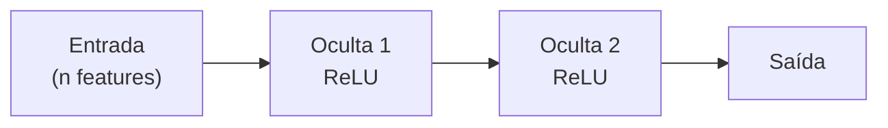

# 2. Classificação

!!! abstract "Entrega 2 de 3 do [Projeto](../index.md)"

    [Projects → Classification](https://insper.github.io/ann-dl/){:target='_blank'}

!!! info "Equipe"

    | Nome completo | GitHub |
    |---------------|--------|
    | Luana Prado Lopes Guimaraes | LuanaPLGuimaraes |
    | Laura Pontiroli Machado | laupontiroli |

    Dataset, decisões e status: [página do projeto](../index.md).

O dataset e as decisões da equipe ficam na [página do projeto](../index.md). As duas
primeiras seções abaixo são exigidas pelo enunciado, mas o [EDA](../eda/index.md) já as
respondeu em profundidade: **resuma e aponte para lá**, em vez de refazer a análise.

## 1. Escolha do dataset

Usamos o **Playground Series — Season 6, Episode 9: Predicting Electric Vehicle Purchases**,
disponibilizado pelo [Kaggle](https://www.kaggle.com/competitions/playground-series-s6e9). O conjunto
de treino tem **534.932 amostras** e o conjunto de teste, **133.733**; são 13 features, além do
identificador `id` e do alvo `Will_Buy_EV`. O dataset permite uma tarefa de classificação binária
com grande volume de dados e sinais associados à decisão de compra, como preocupação ambiental,
renda e disponibilidade de subsídio. A análise completa da escolha está no [EDA](../eda/index.md#1-dataset).

## 2. Descrição do dataset

O objetivo é prever `Will_Buy_EV`, isto é, se a pessoa compraria um veículo elétrico (`Yes` ou
`No`). As features incluem sete variáveis numéricas (`Age`, `Annual_Income_USD`,
`Daily_Commute_km`, `Number_of_Cars_Owned`, `Charging_Stations_Near_Home`,
`Charging_Stations_Near_Work` e `Environmental_Concern_Level`) e seis categóricas (`Gender`,
`City_Type`, `Current_Car_Type`, `Home_Charging_Possible`, `Subsidy_Available` e
`Range_Anxiety_Level`). O alvo está desbalanceado: **82,54% `No` e 17,46% `Yes`**.

Do EDA, herdamos três decisões principais: descartamos `id`, que é identificador; excluímos
`Range_Anxiety_Level` por ser derivada do alvo e representar risco de vazamento; e comparamos
modelos com e sem `Subsidy_Available`, uma preditora muito forte que não foi identificada como
derivada do alvo. Também mantemos o tratamento dos valores no piso de renda e deslocamento e a
winsorização definidos no [plano de pré-processamento do EDA](../eda/index.md#8-plano-de-pre-processamento).

## 3. Limpeza e normalização

Execute o plano de pré-processamento definido no [EDA](../eda/index.md#8-plano-de-pre-processamento)
e relate o que mudou em relação ao planejado — e por quê.

!!! note "Desbalanceamento"

    Se o alvo é desbalanceado, decida aqui como tratar (pesos na perda, reamostragem, ou
    nada) e registre o efeito na seção 8.

## 4. Implementação da MLP

Arquitetura, funções de ativação, função de perda e otimizador, **com a justificativa de cada
escolha**. Uma tabela de hiperparâmetros não explica nada sozinha.

| | Escolha | Por quê |
|---|---------|---------|
| Camadas ocultas | | |
| Ativação | | |
| Função de perda | | |
| Otimizador | | |
| Learning rate | | |
| Batch size | | |

## 5. Treinamento

O loop de treino e as dificuldades enfrentadas: instabilidade, perda que não desce,
saturação da ativação, tempo de época. Diga o que você tentou e o que resolveu.

## 6. Estratégia de treino e teste

Proporções do split, esquema de validação e como o *overfitting* foi contido (early stopping,
regularização, dropout). O split precisa ser o mesmo definido no EDA — se mudou, justifique.

## 7. Curvas de erro

/// caption
**Figura 1** — Perda de treino e de validação por época.
///

Leia a curva no texto: em que época a validação para de melhorar, e o que a distância entre
as duas curvas diz sobre a capacidade do modelo.

## 8. Métricas de avaliação

| Métrica | Treino | Validação | Teste |
|---------|--------|-----------|-------|
| Acurácia | | | |
| Precisão | | | |
| Revocação | | | |
| F1 | | | |
| ROC AUC | | | |

Inclua a matriz de confusão do conjunto de teste e comente os erros que mais custam no
domínio — em dado desbalanceado, acurácia alta pode significar que o modelo aprendeu a
ignorar a classe minoritária.

Compare com o **baseline trivial** do EDA. Um modelo que não supera o baseline é um resultado
— relate-o como tal, não o esconda.

## Conclusão

Principais achados, limitações e o que a equipe faria com mais tempo.

## Referências
